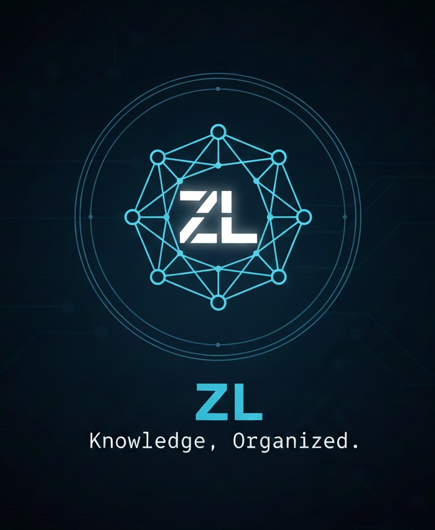

Status: WIP. API/UX unstable. Expect breaking changes.

A minimal, still-in-progress Zettelkasten CLI. Docs/features incomplete.

## Installation
- From crates.io: `cargo install zl --locked`
- From source: `cargo build --release`
- Run: `zl --help`

## Contributing
- Issues/PRs welcome
- Keep changes small, focused
- Be concise in discussions
- Use [conventional commits](https://www.conventionalcommits.org): they determine the next version
  and the changelog. Mark breaking changes with `!` (`feat!: ...`) or a `BREAKING CHANGE:` footer.

## License
GPL-3.0-or-later, see [LICENSE](LICENSE).
